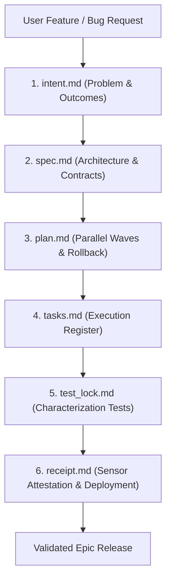

# ai-native-sdlc

[](https://github.com/skupriienko/ai-native-sdlc/actions)
[](https://kilo.org)
[](https://www.python.org/downloads/)
[](https://opensource.org/licenses/MIT)
[](https://github.com/astral-sh/ruff)
[](https://mypy-lang.org/)

> **6-Phase Artifact Loop Engine & Spec-Driven Development Framework for AI Coding Agents**  
> Enforces Anthropic-style AI SDLC: `intent.md` -> `spec.md` -> `plan.md` -> `tasks.md` -> `test_lock.md` -> `receipt.md`.

---

## 🚀 Key Highlights

- **6-Phase Artifact Cycle:** Eliminates unstructured hallucination by forcing agents to define spec, plan, tasks, and test locks before modifying code.
- **CWE-22 Path Traversal Defense:** Sanitizes all epic identifiers and enforces strict filesystem boundary confinement.
- **Structured Artifact Templates:** Auto-generates aerospace-grade markdown artifact scaffolding.
- **Native AI Tooling Integration:** Official first-class configuration for **Kilo Code**, **Claude Code**, **Cursor**, **Windsurf**, and **GitHub Copilot**.
- **Determinism & Performance:** Benchmarked initializing 100 parallel epics in <0.5s.

---

## ⚡ Architecture & Workflow



---

## 📦 Installation

```bash
# Clone and install in editable mode
git clone https://github.com/skupriienko/ai-native-sdlc.git
cd ai-native-sdlc
bash install.sh
```

Or install via `pip`:
```bash
pip install -e .
```

---

## 🛠️ CLI Usage

```bash
# Initialize a new 6-phase epic
sdlc init user-auth-epic

# Check completion status of all 6 phases
sdlc check user-auth-epic

# List all active epics in workspace
sdlc list
```

---

## 🐍 Python API

```python
from ai_native_sdlc import SDLCManager, EpicReport

manager = SDLCManager(base_dir="./artifacts")

# Initialize 6 artifact files
epic_dir = manager.init_epic("payment-gateway")
print(f"Scaffolded epic at: {epic_dir}")

# Check phase completion
status: EpicReport = manager.report("payment-gateway")
print(f"Complete: {status.complete}")
for phase, exists in status.phases.items():
    print(f"  {phase}: {'DONE' if exists else 'PENDING'}")
```

---

## 🤖 AI Tools Compatibility Matrix

| AI Environment | Integration Type | Path / Configuration |
| :--- | :--- | :--- |
| **Kilo / KiloCode** | Native Rules & Tools | `.kilo/kilo.jsonc` & `.kilo/rules/ai-native-sdlc.md` |
| **Cursor** | Project Rules | `.cursorrules` / `.kilo/rules/` |
| **Claude Code** | CLI & Sub-loops | Direct tool call via `sdlc` |
| **Windsurf** | Agent Rules | `.windsurfrules` |
| **Aider / Copilot** | CLI Utilities | Standard shell execution |

---

## 🧪 Testing & Stress Benchmarks

```bash
# Run pytest stress test suite (100 parallel epics initialized in <0.5s)
pytest -v tests/test_stress.py
```

---

## 📄 License

MIT © [Serhii Kupriienko](https://github.com/skupriienko)
